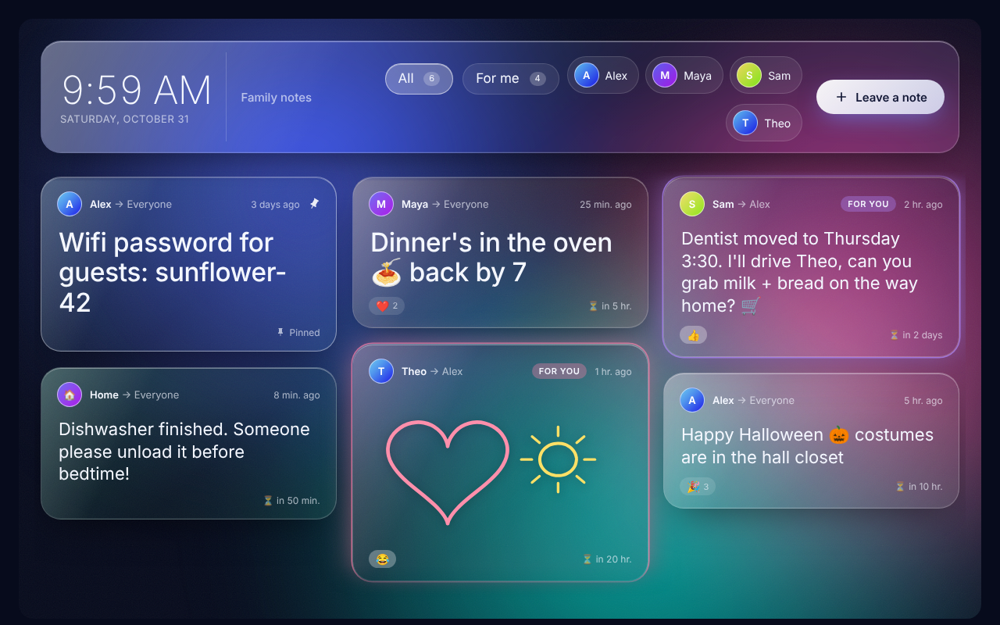
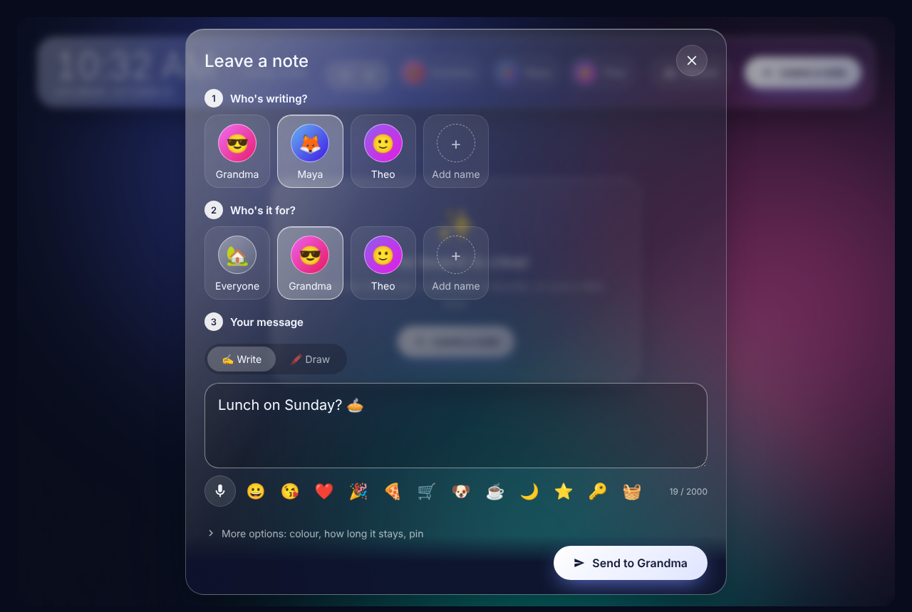
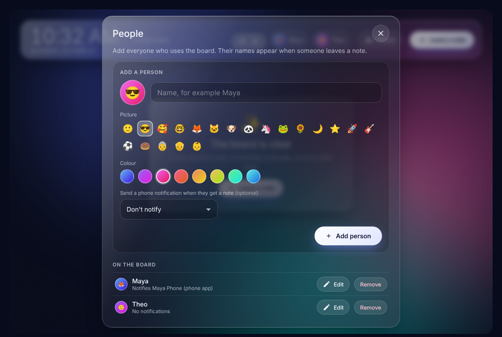
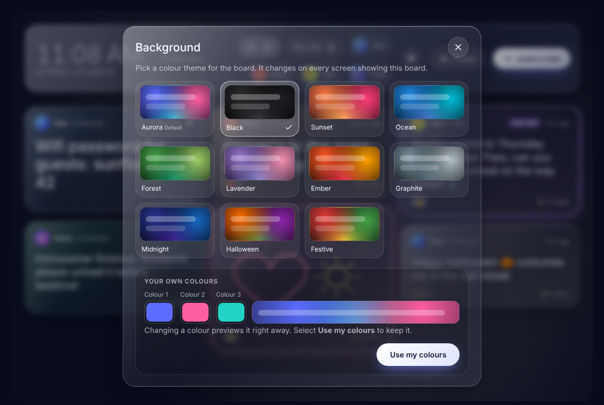
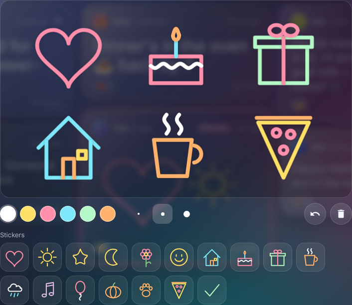

<div align="center">

# Glass Message Board

**A frosted-glass household message board for Home Assistant.**

[](https://hacs.xyz/docs/faq/custom_repositories)
[](https://www.home-assistant.io/)
[](CHANGELOG.md)
[](LICENSE)



</div>

Glass Message Board turns a wall-mounted tablet into a shared space for household notes. Family members can type, dictate or hand-draw messages, address them to one person or to everyone, and react to each other's notes. Important notes can be pinned; everything else expires on schedule. When the tablet is idle, the board fades into an ambient clock that highlights recent notes.

## Contents

- [Features](#features)
- [Requirements](#requirements)
- [Step-by-step setup](#step-by-step-setup)
- [Dashboard configuration](#dashboard-configuration)
- [Notifications](#notifications)
- [Actions](#actions)
- [Entities and events](#entities-and-events)
- [Automation examples](#automation-examples)
- [Permissions and data](#permissions-and-data)
- [WebSocket API](#websocket-api)
- [Troubleshooting](#troubleshooting)
- [Contributing](#contributing)
- [License](#license)

## Features

| Feature | Description |
|---|---|
| **Simple people setup** | Add household members right on the board with a name, emoji picture and colour. No Home Assistant accounts required. Existing Home Assistant users can be shown too. |
| **Guided note form** | Three clear steps: who's writing, who it's for, and the message. Advanced options stay tucked away until needed. |
| **Write, dictate or draw** | Touch-optimized text input with quick emoji, browser-based voice dictation, and a handwriting pad with six ink colors, three pen sizes and undo. |
| **Stickers** | Seventeen ready-made doodles (heart, sun, star, cake, gift, balloon and more) to tap onto a note and combine with your own drawing. |
| **Pinning and expiry** | Notes can last 1 hour, until tonight, 1 day, 1 week, or indefinitely. Pinned notes never expire and always appear first. |
| **Reactions and replies** | Open any note to react, reply to the sender, pin it or delete it. |
| **Background themes** | Eleven colour presets, including seasonal ones, plus your own three-colour mix. Changes apply to every screen at once. |
| **Ambient mode** | After a configurable idle period, the board shows a large clock and a rotating spotlight of notes, prioritizing those for the current user. |
| **Automation support** | Actions, a new-message event and per-person sensors let automations post notes and respond to them. |
| **Mobile notifications** | Pick a person's phone on the People screen and they get a push notification when a note is left for them. |

<p align="center">
  
  
</p>

### Architecture

A single installation provides two components:

- **Integration** (`glass_messages`): stores and expires notes, and provides actions, sensors, events and notifications.
- **Dashboard card** (`custom:glass-message-board`): the board itself, served by the integration and loaded on your dashboards.

## Requirements

- Home Assistant **2024.11** or later. On **2026.11** and later, install through the built-in **Marketplace**; on earlier versions, use **HACS**.
- HTTPS access to Home Assistant, if you want voice dictation (browsers require it for the microphone).
- A GitHub account, to add the repository to the Marketplace or HACS.

## Step-by-step setup

Follow these parts in order. Each one only needs to be done once.

### Part 1: Install the integration

**Using the Marketplace (Home Assistant 2026.11 and later)**

1. Go to **Settings → Marketplace**.
2. The first time, read the community-content warning and confirm.
3. Choose **Add via link**, paste `https://github.com/Degederon/GlassMessageBoard`, and choose **Integration** if asked. You may be asked to connect your GitHub account.
4. Open **Glass Message Board** and select **Install**.
5. Restart Home Assistant: **Settings → System**, select the power icon (top right), then **Restart Home Assistant**.

**Using HACS (earlier versions)**

1. In HACS, open the menu (⋮) and select **Custom repositories**.
2. Paste `https://github.com/Degederon/GlassMessageBoard`, choose the category **Integration**, and select **Add**.
3. Search for **Glass Message Board** and install it.
4. Restart Home Assistant.

**Manual installation**

1. Download the latest release.
2. Copy `custom_components/glass_messages` into your `config/custom_components/` folder.
3. Restart Home Assistant.

### Part 2: Turn on the integration

Downloading the integration is not enough; it also has to be added.

1. Go to **Settings → Devices & services**.
2. Select **+ Add integration** (bottom right).
3. Search for **Glass Message Board**, select it, then select **Submit**.

To confirm it's working, open **Glass Message Board** on the **Devices & services** page. You should see a device with a **Messages** sensor, plus one sensor for each Home Assistant person.

### Part 3: Load the board's display file

This makes sure your browser can draw the board. Skipping it is the most common cause of a red **Configuration error** box.

1. If you don't see **Resources** in the next step, turn on **Advanced mode** first: select your **profile picture** (bottom left) and switch on **Advanced mode**.
2. Go to **Settings → Dashboards**, select **⋮** (top right), then **Resources**.
3. Select **+ Add resource** and enter:
   - **URL:** `/glass_messages/glass-message-board.js`
   - **Resource type:** **JavaScript module**
4. Select **Create**.
5. Refresh the page:
   - **Computer:** press **Ctrl + Shift + R** (Mac: **Cmd + Shift + R**).
   - **Companion app:** go to **Settings → Companion app → Debugging → Reset frontend cache**, then reopen the app.

> [!TIP]
> To check that the file is reachable, open your Home Assistant address followed by `/glass_messages/glass-message-board.js`, for example `http://homeassistant.local:8123/glass_messages/glass-message-board.js`. You should see a page of code.

### Part 4: Create the dashboard

1. Go to **Settings → Dashboards** and select **+ Add dashboard**.
2. Choose **New dashboard from scratch**, then **Next**.
3. Enter the title `Family Notes`, leave **Show in sidebar** on, and select **Create**.
4. Open **Family Notes** from the sidebar.
5. Select the **pencil** icon (top right), then **⋮**, then **Raw configuration editor**.
6. Delete everything in the editor and paste:

   ```yaml
   title: Family Notes
   views:
     - title: Notes
       path: notes
       icon: mdi:message-text-outline
       type: panel
       cards:
         - type: custom:glass-message-board
           title: Family notes
           ambient_after: 90
           column_width: 300
           show_clock: true
   ```

7. Select **Save**, close the editor with **X**, then select **Done**.

You should now see the glass board with a welcome screen.

> [!IMPORTANT]
> The Marketplace also adds a tile called **Glass Message Board – Up-to-date**. That tile only tracks updates; it is not the board. If you added it to a dashboard by mistake, edit the dashboard, select the tile and choose **Delete**.

### Part 5: Add your household

1. On the board, select **Add people** (or **People** in the header).
2. Type a name, then choose an emoji **Picture** and a **Colour**.
3. Optional: under **Send a phone notification**, choose that person's phone. Phones appear once the Home Assistant app is installed and signed in on them.
4. Select **Add person**. Repeat for everyone in your home.
5. Close the window with **X**.

To change someone later, open **People** and select **Edit** or **Remove** (select **Remove** twice to confirm).

> [!NOTE]
> Home Assistant users (`person` entities) appear on the board automatically. To hide them, open **People** and switch off **Home Assistant users**.

### Part 6: Leave a note

1. Select **Leave a note**.
2. **Who's writing?** Select your picture.
3. **Who's it for?** Select a person, or **Everyone**.
4. **Your message.** Choose one way:
   - **Type** in the box. Select an emoji from the row to insert it.
   - **Speak**: select the **microphone**, talk, then select it again to stop.
   - **Draw**: open the **Draw** tab and draw with your finger. Choose ink colours and pen sizes; **undo** removes the last line.
   - **Stickers**: on the **Draw** tab, tap any sticker under **Stickers** to add it to the note. Add several, draw around them, and use **undo** to remove the last one.
5. Optional: select **More options** to choose a note colour, how long it stays (1 hour to Keep), or **Pin** it so it never expires.
6. Select **Send to [name]**.

If someone isn't on the board yet, select **Add name** in step 2 or 3 and type their name.

### Part 7: Read and reply to notes

- Notes addressed to you glow and show a **For you** badge.
- Use the buttons at the top to filter: **All**, or a person to see only their notes.
- Select a note to open it, then:
  - Select an emoji to **react**.
  - Select **Reply** to write back to the sender.
  - Select **Pin** or **Unpin**.
  - Select **Delete**, then select it again to confirm.

### Part 8: Change the background (optional)

1. Select the **palette** button in the header, next to **People**.
2. Select a theme. The board changes straight away on every screen. **Aurora** is the default.
3. To use your own colours, change **Colour 1**, **Colour 2** and **Colour 3** under **Your own colours**. The board previews each change. Select **Use my colours** to keep them.
4. Close the window with **X**.

<p align="center"></p>

<p align="center"></p>

Available presets: Aurora, Black, Sunset, Ocean, Forest, Lavender, Ember, Graphite, Midnight, Halloween and Festive.

### What happens automatically

- **Expiry:** notes disappear at the time chosen when they were written. Pinned notes stay.
- **Ambient mode:** after 90 seconds without a touch, the board shows a large clock and cycles through recent notes. Tap anywhere to wake it.
- **Phone notifications:** people with a phone selected are notified when a note is left for them or for everyone.

## Dashboard configuration

For wall tablets, add the card to a **Panel** view (or a full-width **Sections** view) so it fills the screen. The card can be configured in the visual editor or in YAML:

```yaml
type: custom:glass-message-board
title: Family notes
ambient_after: 90
height: 100vh
column_width: 300
show_clock: true
background_image: /local/wallpaper.jpg
```

| Option | Type | Default | Description |
|---|---|---|---|
| `title` | string | `Messages` | Title shown in the header. Leave empty to hide it. |
| `ambient_after` | number | `90` | Seconds of inactivity before ambient mode starts. Set to `0` to disable. |
| `height` | string | Fills the viewport | Any CSS height, such as `100vh` or `720px`. |
| `column_width` | number | `300` | Approximate width of each note column, in pixels. |
| `show_clock` | boolean | `true` | Shows the clock and date in the header. |
| `background_image` | string | — | Optional image URL displayed behind the glass. |

> [!TIP]
> For a dedicated wall display, run the dashboard in kiosk mode, for example with Fully Kiosk Browser.

## Notifications

The easiest way to set up notifications is on the board itself: open **People**, edit a person and choose their phone. Phones appear in the list once the Home Assistant app is installed on them.

For Home Assistant `person` entities, and for extra settings, go to **Settings → Devices & services → Glass Message Board → Configure**.

| Setting | Description |
|---|---|
| **Per-person services** | The `notify` service(s) for each Home Assistant `person`, for example `notify.mobile_app_pixel_8`. |
| **Extra services for notes to everyone** | Additional services notified for every note addressed to everyone. |
| **Notification tap path** | Dashboard path to open when a notification is tapped, for example `/lovelace/notes`. |
| **Default note lifetime** | The expiry option preselected when composing, in hours. `0` keeps notes indefinitely. |

**Delivery rules**

- A note addressed to a person notifies that person's services.
- A note addressed to everyone notifies every configured person except the sender, plus any extra services.
- Set `notify: false` on a note to post it silently.

## Actions

| Action | Description | Fields |
|---|---|---|
| `glass_messages.post` | Posts a note. Returns the note `id`. | `message`, `to`, `from`, `sender_name`, `expires_in`, `expires_at`, `pinned`, `tint`, `notify` |
| `glass_messages.delete` | Deletes a note. | `id` |
| `glass_messages.pin` | Pins or unpins a note. | `id`, `pinned` |
| `glass_messages.react` | Toggles an emoji reaction. | `id`, `emoji`, `from` |
| `glass_messages.clear` | Removes all notes. Returns the number removed. | `include_pinned` |
| `glass_messages.set_background` | Changes the board's colour theme on every screen. | `preset`, `colors` |

### `glass_messages.post` fields

| Field | Required | Description |
|---|---|---|
| `message` | Yes | Note text, up to 2,000 characters. |
| `to` | No | A `person` entity, a board member ID (`member.…`), or `everyone` (default). |
| `from` | No | Sender `person` entity or board member ID. Defaults to the user who ran the action. |
| `sender_name` | No | Display name for notes not sent by a person, such as `Laundry`. |
| `expires_in` | No | Lifetime in minutes. |
| `expires_at` | No | Exact expiry date and time. Takes precedence over `expires_in`. |
| `pinned` | No | Pins the note. Default `false`. |
| `tint` | No | One of `clear`, `rose`, `amber`, `mint`, `sky`, `violet`. Default `clear`. |
| `notify` | No | Sends notifications. Default `true`. |

```yaml
action: glass_messages.post
data:
  message: "The washer is done."
  to: everyone
  sender_name: Laundry
  expires_in: 120
  tint: mint
response_variable: note
```

## Entities and events

### Sensors

| Entity | State | Attributes |
|---|---|---|
| `sensor.glass_message_board_messages` | Total number of notes | `pinned`, `latest_text`, `latest_from`, `latest_at` |
| `sensor.glass_message_board_messages_for_<person>` | Notes addressed to that person or to everyone, excluding their own | `direct`, `pinned`, `latest_text`, `latest_from`, `latest_at` |

### Events

`glass_messages_new` fires whenever a note is posted, with the following data:

| Key | Description |
|---|---|
| `id` | Note identifier |
| `text` | Note text (first 255 characters) |
| `has_drawing` | Whether the note includes a drawing |
| `sender` / `sender_name` | Sender entity and display name |
| `recipient` | `person` entity or `everyone` |
| `pinned` | Whether the note is pinned |

## Automation examples

### Wake the tablet screen when a note arrives

```yaml
triggers:
  - trigger: event
    event_type: glass_messages_new
actions:
  - action: switch.turn_on
    target:
      entity_id: switch.hallway_tablet_screen
```

### Post a recurring reminder

```yaml
triggers:
  - trigger: time
    at: "07:00:00"
conditions:
  - condition: time
    weekday: [tue]
actions:
  - action: glass_messages.post
    data:
      message: "Bins go out tonight."
      sender_name: Home
      expires_in: 960
      tint: amber
```

### Switch to a seasonal background

```yaml
triggers:
  - trigger: time
    at: "00:00:00"
conditions:
  - condition: template
    value_template: "{{ now().month == 10 and now().day == 31 }}"
actions:
  - action: glass_messages.set_background
    data:
      preset: halloween
```

To use your own colours from an automation, set `preset: custom` and `colors: "#ff7a45, #ff3d77, #ffc15e"`. To go back to the default, set `preset: aurora`.

## Permissions and data

| Action | Allowed for |
|---|---|
| Post, react, pin, manage people, change the background | All users |
| Delete | Administrators, the sender and the recipient |

- Notes are stored locally in `.storage/glass_messages.messages`. No data leaves your Home Assistant instance except through the notification services you configure.
- Up to 200 notes and 30 board members are retained. When the limit is reached, the oldest unpinned notes are removed first.
- Drawings are stored as compact vector strokes rather than images.

## WebSocket API

Custom frontends can use the following commands:

| Command | Description |
|---|---|
| `glass_messages/subscribe` | Sends a snapshot of all notes, followed by `added`, `updated` and `removed` events. |
| `glass_messages/post` | Posts a note, optionally with a drawing. |
| `glass_messages/delete` | Deletes a note. |
| `glass_messages/pin` | Pins or unpins a note. |
| `glass_messages/react` | Toggles a reaction. |
| `glass_messages/member/save` | Adds or updates a board member. |
| `glass_messages/member/remove` | Removes a board member. |
| `glass_messages/settings` | Shows or hides Home Assistant users, and changes the background. |

## Troubleshooting

### A red "Configuration error" box appears instead of the board

Your browser hasn't loaded the board's display file. Work through these steps in order and check the dashboard after each one.

1. Go to **Settings → Devices & services** and check that **Glass Message Board** is listed. If it isn't, complete [Part 2](#part-2-turn-on-the-integration).
2. Restart Home Assistant, then hard-refresh the page (**Ctrl + Shift + R**, or **Reset frontend cache** in the companion app).
3. Complete [Part 3](#part-3-load-the-boards-display-file) to add the resource, then refresh again.
4. Open your Home Assistant address followed by `/glass_messages/glass-message-board.js`.
   - If you see a page of code, the file is fine: clear the browser cache and try again.
   - If you see **404: Not Found**, go to **Settings → System → Logs**, search for `glass`, and include what you find when reporting the problem.
5. Still red? Edit the dashboard, select the red card, and note the full error text underneath. Include it when reporting the problem.

### Other problems

| Problem | Solution |
|---|---|
| The board shows **Almost there** | The integration is downloaded but not added. Complete [Part 2](#part-2-turn-on-the-integration), then refresh the page. |
| A tile says **Glass Message Board – Up-to-date** | That is the update tracker, not the board. Delete the tile and add the board as described in [Part 4](#part-4-create-the-dashboard). |
| The board is small or squeezed | Edit the view (pencil next to the tab name) and set **View type** to **Panel**. |
| The microphone button is missing | The browser doesn't support speech recognition. Chrome, Edge and Safari support it. |
| Dictation reports **Microphone blocked** | Open Home Assistant over HTTPS and allow microphone access in the browser. |
| No push notifications | Open **People**, edit the person and check that a phone is selected. For Home Assistant `person` entities, check **Settings → Devices & services → Glass Message Board → Configure**. |
| A phone is missing from the list | Install the Home Assistant app on that phone and sign in, then reopen the People screen. |
| The board still looks like the old version after an update | Hard-refresh the browser, or reset the companion app's frontend cache. |

## Contributing

Bug reports and pull requests are welcome. When reporting a problem, please include your Home Assistant version, browser, and any relevant entries from the Home Assistant log.

## License

Released under the [MIT License](LICENSE).
